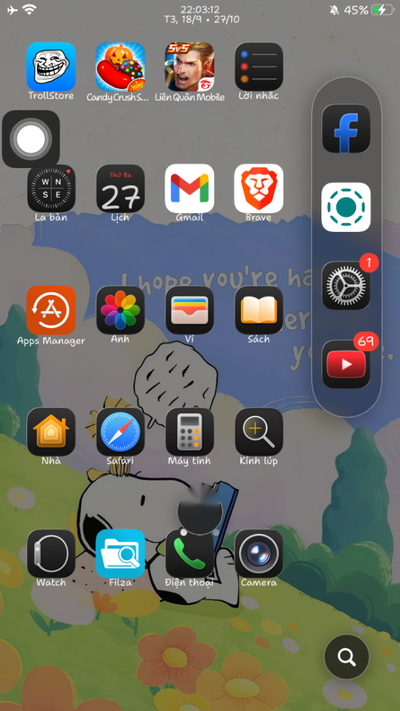
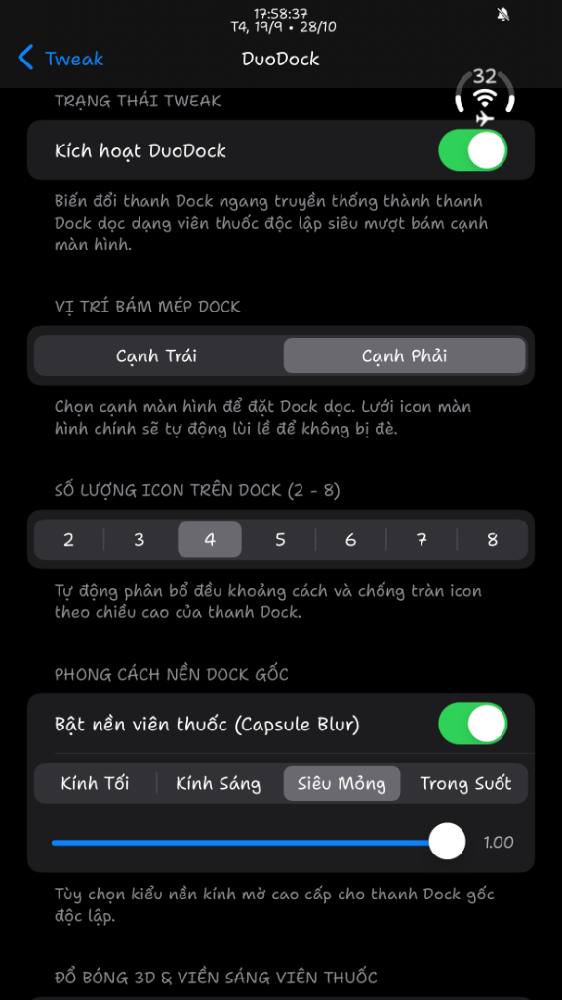

# DuoDock 🚀

Tweak tùy biến thanh Dock nằm ngang thành **thanh Dock dọc dạng viên thuốc** bám cạnh màn hình, đi kèm **nút tìm kiếm Spotlight thông minh** dành cho iOS 15.0 - 16.7.x (Rootless).

---

> [!WARNING]
> **Lưu ý & Miễn trừ trách nhiệm:**
> Phần mềm đang trong quá trình phát triển và có thể gặp lỗi. Bạn tự chịu trách nhiệm với thiết bị của mình khi cài đặt và sử dụng tweak jailbreak. Tác giả không chịu trách nhiệm nếu xảy ra lỗi phần mềm, treo máy hoặc mất dữ liệu.

---

## 📱 Thiết bị thử nghiệm
- **Thiết bị tác giả sử dụng**: iPhone 7 Plus (Chip A10 Fusion)
- **Phiên bản iOS**: iOS 15.8.x
- **Jailbreak**: Dopamine (Rootless)
- **Tình trạng**: Đã test hoạt động mượt mà, không gây Safe Mode, không đơ màn hình chính hay phím ảo AssistiveTouch.

---

## 📸 Hình ảnh Demo

<!-- Đặt ảnh chụp màn hình của bạn vào thư mục: assets/screenshots/ -->

  <table align="center">
    <tr>
      <td align="center" width="33%">
        <b>Dock dọc bám mép</b>  
         
        Bám mép trái hoặc phải
      </td>
      <td align="center" width="33%">
        <b>Nút tìm kiếm Spotlight</b>  
         
        Tự đảo vị trí thông minh
      </td>
      <td align="center" width="33%">
        <b>Giao diện Cài đặt</b>  
         
        Tùy chỉnh trong Settings
      </td>
    </tr>
  </table>

---

## ✨ Tính năng nổi bật

- **Dock dọc dạng viên thuốc**: Chọn đặt ở cạnh Trái hoặc Phải; tùy chỉnh kích thước chiều rộng, chiều cao và độ bo tròn.
- **Nút tìm kiếm Spotlight cạnh Dock**:
  - Chạm để mở nhanh Spotlight kèm hiệu ứng lò xo và rung nhẹ.
  - **Tự động đảo vị trí**: Khi kéo Dock sát mép dưới, nút tìm kiếm sẽ tự nhảy lên **trên đỉnh Dock** để không bị che khuất.
  - **Đồng bộ với Dock**: Nút tự đổi màu kính mờ, viền sáng và bóng đổ đồng bộ theo thanh Dock.
  - **Tùy chọn màu icon**: Hỗ trợ màu Trắng, Đen, Xám, Xanh, Đỏ hoặc Tự động đổi màu tương phản.
- **4 Kiểu nền kính mờ**: Kính Tối, Kính Sáng, Siêu Mỏng, Trong Suốt.
- **Chống đè icon**: Màn hình chính tự động lùi lề icon sang một bên để không bị Dock che mất icon.
- **Tùy chọn 2 - 8 icon**: Tự động chia đều khoảng cách các ứng dụng trên Dock.
- **Cảm ứng mượt mà**: Không cướp touch, vuốt chạm icon chính và phím ảo AssistiveTouch hoàn toàn bình thường.

---

## 📥 Cách cài đặt

1. Tải file **[DuoDock_rootless.deb](https://github.com/Hoangnguyennaaa/DuoDock/releases/latest)** về máy.
2. Mở file `.deb` bằng **Sileo**, **Zebra** hoặc **Filza** rồi chọn **Cài đặt**.
3. Chọn **Khởi động lại SpringBoard (Respring)**.
4. Mở ứng dụng **Cài đặt (Settings)** -> chọn mục **DuoDock** để bật và chỉnh các tùy chọn theo ý thích.

---

## 💖 Ủng hộ tác giả (Donate)

Nếu bạn yêu thích tweak và muốn ủng hộ một ly cà phê để tác giả có thêm động lực cập nhật, bạn có thể quét mã QR dưới đây:

<!-- Đặt ảnh mã QR của bạn vào thư mục: assets/donations/ -->

  <table align="center">
    <tr>
      <td align="center" width="50%">
        <b>Chuyển khoản Ngân hàng</b>  
          
        <b>Ngân hàng</b>: <code>[Tên ngân hàng của bạn]</code> 
        <b>Số tài khoản</b>: <code>[Số tài khoản]</code> 
        <b>Chủ tài khoản</b>: <code>[Tên chủ tài khoản]</code>
      </td>
      <td align="center" width="50%">
        <b>Ví điện tử MoMo</b>  
          
        <b>Số MoMo</b>: <code>[Số điện thoại MoMo]</code> 
        <b>Chủ tài khoản</b>: <code>[Tên chủ tài khoản]</code> 
        <b>Nội dung</b>: <code>Ung ho DuoDock</code>
      </td>
    </tr>
  </table>

---

## 📄 Bản quyền
Mã nguồn mở phát hành theo giấy phép [MIT License](LICENSE).
 Phát triển bởi **Hoangnguyen**.
